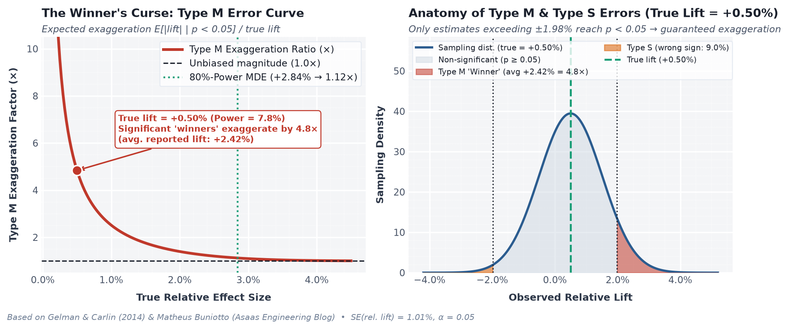

# A/B test analysis on landing page social proof


[Versão em português](README.pt-BR.md)

This project runs a full A/B test analysis on the [Kaggle landing page dataset](https://www.kaggle.com/datasets/zhangluyuan/ab-testing) of 294,478 rows. It covers pre-experiment planning, metric selection, Type M and Type S error rates, data cleaning, Sample Ratio Mismatch, frequentist z-tests, bootstrap resampling, and conjugate Bayesian inference. It then cross-checks the results with [`tea-tasting`](https://github.com/e10v/tea-tasting) and runs store-level cluster randomization and single-cluster synthetic control simulations with [`cluster-experiments`](https://david26694.github.io/cluster-experiments/). All plots use a shared ggplot2 layout.

> **Summary.** The new landing page did not improve conversion. Conversion moved from `12.02%` in control to `11.87%` in treatment, an absolute change of `−0.14 pp` and a relative change of `−1.20%` with `p = 0.232`. Across 286,690 clean users collected over 22 days, the test had 80% power to detect a lift of `±0.34 pp`, or `±2.84%` relative. The Bayesian posterior gives an `11.6%` probability that treatment beats control. Do not ship the new page.

> [!NOTE]
> **Why I updated this repository four years later.** I wrote the first version of this repository almost four years ago as a basic user-level A/B test exercise. Since then, I have run and led Data and Product teams through hundreds of experiments in production. This update adds the practices that mattered most in those reviews:
> - **Pre-experiment design.** Define the primary decision metric, secondary diagnostic metrics, and guardrail metrics before launch. Choose between superiority and non-inferiority tests based on the product goal, and size the sample from a pre-agreed Minimum Detectable Effect.
> - **Type M and Type S error checks.** Low-power tests that cross `p < 0.05` overestimate the true effect and can flip its sign. Section 0.4 applies the framework from my Asaas Data & Engineering blog post, [*O Erro Secreto: O Erro Tipo M em Testes A/B*](https://medium.com/estacao-asaas/o-erro-secreto-o-erro-tipo-m-em-testes-a-b-e5593833bc01).
> - **Library validation and clustered designs.** We cross-check the user-level estimators and power curves with [`tea-tasting`](https://github.com/e10v/tea-tasting) and model store-level randomization and synthetic control with [`cluster-experiments`](https://david26694.github.io/cluster-experiments/).

---

## Scorecard

| Stage | Metric | Result | Threshold or 95% interval | Verdict |
|---|---|---|---|---|
| **0. Experiment design** | Target MDE and runtime | `±0.34 pp`, `±2.84%` relative | `N = 286,690`, 22 days, `80%` power, `α = 0.05` | **PRE-SPECIFIED** |
| **0.4 Type M and Type S** | Exaggeration at `80%` MDE vs `+0.5%` | `1.12×` at MDE, `4.84×` at `+0.5%` | Caps winner's curse inflation at `1.12×` | **GUARDED AT ≥2.84%** |
| **1. Data hygiene** | Repeated or mismatched rows | `7,788` rows, `2.64%` dropped | `0` mismatches in `286,690` clean users | **PASS** |
| **2. SRM check** | Control vs treatment split | `143,293` vs `143,397`, ratio `0.9993` | `χ² = 0.0377`, `p = 0.8460`, threshold `0.001` | **PASS** |
| **3. Frequentist z-test** | Absolute and relative lift | `−0.14 pp`, `−1.20%` relative | 95% CI `[−0.38 pp, +0.09 pp]`, `p = 0.2323` | **NOT SIGNIFICANT** |
| **4. Bootstrap 10k** | Resampled lift | `−0.14 pp`, `−1.20%` relative | 95% CI `[−0.39 pp, +0.09 pp]`, `p = 0.2324` | **NOT SIGNIFICANT** |
| **5. Bayesian Beta** | `P(Treatment > Control)` | `11.6%` vs `88.4%` control | 95% CrI `[−0.38 pp, +0.09 pp]` | **DO NOT SHIP** |
| **6. `tea-tasting` MDE** | Sensitivity power check | `±0.34 pp`, `±2.84%` relative | 80% power, two-sided `α = 0.05` | **WELL-POWERED** |
| **7. Clustered OLS** | Store-randomized SE ratio | `SE = $2.92` vs naive `$0.64` | `4.5x` SE ratio, `p = 0.5017` vs `0.0023` | **PREVENTS FALSE POSITIVE** |
| **8. Synthetic control** | 1-treated-cluster false positive rate | `0%` FPR, `100%` power at `+10` | Clustered OLS hits `75%` FPR at `effect = 0` | **REQUIRED FOR N=1 CLUSTER** |

---

## Repository files

| File | Description |
|---|---|
| [`analysis.ipynb`](analysis.ipynb) | Executed notebook with the planning section, Type M and Type S audit, statistical tests, and charts |
| [`ab_utils.py`](ab_utils.py) | Functions for the ggplot2 theme, SRM test, Wilson CIs, z-test, bootstrap, Bayesian model, Type M and Type S audit, `tea-tasting`, and `cluster-experiments` |
| `plots/*.png` | Seven two-panel ggplot2 diagnostic charts |
| `data/ab_data.csv` | Raw experiment log with `user_id`, `timestamp`, `group`, `landing_page`, and `converted` |
| [`README.pt-BR.md`](README.pt-BR.md) | Portuguese version of this README |

## Quick start

```bash
pip install -r requirements.txt
jupyter notebook analysis.ipynb
```

You can also call the analysis functions directly from Python:

```python
from ab_utils import (
    srm_test,
    perform_ab_test_analysis,
    bootstrap_ab_test,
    bayesian_ab_test,
    compare_with_tea_tasting,
    analyze_type_m_s_errors,
    run_cluster_randomization_example,
    run_synthetic_control_example,
)

srm_test(control_count, treatment_count)
perform_ab_test_analysis(df)
bootstrap_ab_test(df)
bayesian_ab_test(df)
compare_with_tea_tasting(df)
analyze_type_m_s_errors(df)
run_cluster_randomization_example()
run_synthetic_control_example()
```

---

## Part I. User-level landing page experiment

### 0. Experiment planning phase

Before writing analysis code, we translate the product manager's request into a pre-registered experiment plan:

```text
Hi Matheus!
I'd like to test a hypothesis on our landing page: adding social proof ("98% of customers are
satisfied", "Recommended by Forbes, CNN, and The New York Times", "Over 1M happy customers")
will build trust and increase our conversion rate.

To test this, we'll split incoming visitors 50/50 between the current landing page (control)
and the new version with social proof (treatment) and compare conversion rates.
```

Following Kohavi et al. in *Trustworthy Online Controlled Experiments* and Georgiev in *Statistical Methods in Online A/B Testing*, the plan specifies the metrics, hypothesis structure, and sample size before traffic starts.

#### 0.1 Metric hierarchy

The public Kaggle dataset only includes the binary `converted` column, but a production test tracks three groups of metrics:

- **Primary decision metric.** Conversion rate per unique user, recorded in `converted`, decides whether the hypothesis passes.
- **Secondary diagnostic metrics.** CTA click-through rate, scroll depth to the social proof block, and time to convert explain why conversion moved or stayed flat.
- **Guardrail metrics.** System guardrails track Sample Ratio Mismatch, p95 page load latency, and client error rate, because extra widgets or images can slow down rendering. Business guardrails track bounce rate, refund or cancellation rate, and average order value so aggressive social proof does not bring in low-intent signups.

#### 0.2 Choosing between superiority and non-inferiority tests

The product goal determines the null and alternative hypotheses:

- **Superiority test.** When a change adds maintenance cost or page complexity, we only ship if treatment beats control, testing $H_0: \Delta = 0$ against $H_1: \Delta \neq 0$, or one-sided $H_1: \Delta > 0$.
- **Non-inferiority test.** When a change is required for a rebrand, legal compliance, or a frontend migration, it does not need to increase conversion. It only needs to avoid hurting conversion by more than a pre-agreed margin $-\Delta_{\text{NI}}$, testing $H_0: p_T - p_C \le -\Delta_{\text{NI}}$ against $H_1: p_T - p_C > -\Delta_{\text{NI}}$. With our observed 95% confidence interval of `[−0.38 pp, +0.09 pp]`, the new page fails a superiority test, and it would only pass a non-inferiority test if the team accepted a drop of at least `−0.40 pp`, or `−3.3%` relative.

#### 0.3 Defining the MDE and sample size

The Minimum Detectable Effect is the smallest true lift worth detecting at 80% statistical power, $1 - \beta = 0.80$, and a 5% significance level, $\alpha = 0.05$. Teams choose the MDE during planning by trading off the smallest business-meaningful lift against available traffic, which averages 13,031 clean users per day in this log at a `12.0%` baseline conversion rate:

| Target relative MDE | Absolute lift $\Delta$ | Required total sample $N$ | Estimated runtime at 13k users/day | Trade-off |
|---|---|---|---|---|
| **±1.00%** | `±0.12 pp` | `2,312,270` | 177 days, 25 weeks | Too slow for a UI copy change without CUPED or more traffic |
| **±2.00%** | `±0.24 pp` | `580,545` | 45 days, 6.5 weeks | High precision, moderate runtime |
| **±2.84%, this dataset** | **`±0.34 pp`** | **`286,690`** | **22 days, 3 full weeks** | **Covers 3 weekly cycles and detects a ≥2.84% lift at 80% power** |
| **±5.00%** | `±0.60 pp` | `94,072` | 7.2 days, 1 full week | Fast check for major layout changes |
| **±10.00%** | `±1.20 pp` | `24,007` | 2 days, extend to 7 days | Always run at least one full week to cover weekday and weekend cycles |

> [!IMPORTANT]
> **Why we compute retrospective sensitivity MDE instead of observed post-hoc power.** Georgiev shows that plugging the noisy observed lift of `−0.14 pp` into a power formula after the test finishes is uninformative, because post-hoc power is just a transformation of the p-value. When auditing a historical dataset with $N = 286,690$, we instead compute the sensitivity MDE of `±0.34 pp`, or `±2.84%` relative, to see what effect size the sample could detect at 80% power. Because `±2.84%` is smaller than the 3% to 5% lift usually required for a landing page change, our non-significant result with `p = 0.232` is a well-powered null finding.

#### 0.4 Type M magnitude and Type S sign errors

Standard power calculations only track Type I, $\alpha$, and Type II, $\beta$, errors. In practice, one of the costliest mistakes in product experimentation happens when an underpowered test crosses $p < 0.05$ by chance. I wrote a detailed breakdown of this problem for the Asaas Data & Engineering blog in [*O Erro Secreto: O Erro Tipo M em Testes A/B*](https://medium.com/estacao-asaas/o-erro-secreto-o-erro-tipo-m-em-testes-a-b-e5593833bc01), based on Gelman and Carlin from 2014:

1. **Type M error, exaggeration ratio $\mathbb{E}[|\hat{\Delta}| \mid p < 0.05] / |\Delta_{\text{true}}|$.** A two-sided test at $\alpha = 0.05$ only flags a result as significant when the observed lift exceeds $1.96 \times \text{SE}$, which is `±1.98%` relative in our dataset. If the true effect of a feature is small, such as `+0.50%`, the only way a test can reach $p < 0.05$ is if random sampling noise pushes the estimate past `+1.98%`. Conditional on being statistically significant, the reported lift is guaranteed to overestimate the true effect, averaging **4.84×** the truth at `+0.50%` and **9.52×** at `+0.25%`. Teams that roll up these exaggerated wins into revenue plans consistently miss their targets.
2. **Type S error, wrong sign probability $P(\text{wrong sign} \mid p < 0.05)$.** When statistical power is low, a significant result can also point in the opposite direction of the true effect. At a `+0.25%` true relative lift, **23.92%** of statistically significant results are negative.

Calling `analyze_type_m_s_errors(ab_clean)` computes the exact Type M and Type S error rates for our dataset's relative standard error of $\text{SE}_{\text{rel}} = 1.01\%$:

```text
╭────────────────────────────────────────────────────────────────────╮
│ TYPE M (MAGNITUDE) & TYPE S (SIGN) ERROR AUDIT                     │
├────────────────────────────────────────────────────────────────────┤
│  True Rel. Lift True Abs. Lift Power Type S (Wrong Sign) Type M (Exaggeration) Avg. Winner Reported│
│          +0.25%       +0.03 pp  5.7%              23.92%                 9.52x               +2.38%│
│          +0.50%       +0.06 pp  7.8%               8.98%                 4.84x               +2.42%│
│          +1.00%       +0.12 pp 16.7%               0.95%                 2.52x               +2.52%│
│          +1.50%       +0.18 pp 31.7%               0.09%                 1.76x               +2.64%│
│          +2.00%       +0.24 pp 50.8%               0.01%                 1.40x               +2.79%│
│          +2.84%       +0.34 pp 80.2%               0.00%                 1.12x               +3.19%│
│          +5.00%       +0.60 pp 99.9%               0.00%                 1.00x               +5.00%│
├────────────────────────────────────────────────────────────────────┤
│  [INSIGHT] Underpowered 'winners' exaggerate true lift by 2.5x–9.5x (Winner's Curse!).│
╰────────────────────────────────────────────────────────────────────╯
```


Sizing the experiment to 80% power at the `+2.84%` MDE keeps the Type M exaggeration factor down at `1.12×` and reduces the Type S error rate to `0.00%`.

---

### 1. Data hygiene and variant consistency

The raw table has 294,478 rows logged between `2017-01-02` and `2017-01-24`, with no missing values and no duplicate rows. However, 3,894 `user_id` values appear more than once, accounting for 7,788 rows, or `2.64%` of the table. Among those repeated users, 1,895 saw both `control` and `treatment`, and 3,893 rows have a mismatch between `group` and `landing_page`.

Because the dataset has no session or assignment rule to pick one valid row per repeated user, we drop all rows belonging to any `user_id` that appears more than once. That removes all 3,893 mismatches and leaves **286,690 unique users**:

```text
╭────────────────────────────────────────────────────────────────────╮
│ GROUP / LANDING PAGE CONSISTENCY                                   │
├────────────────────────────────────────────────────────────────────┤
│  landing_page  new_page  old_page                                  │
│  group                                                             │
│  control              0    143293                                  │
│  treatment       143397         0                                  │
├────────────────────────────────────────────────────────────────────┤
│  [PASS] 0 rows where group and landing page disagree               │
╰────────────────────────────────────────────────────────────────────╯
```

### 2. Sample Ratio Mismatch check

```text
╭────────────────────────────────────────────────────────────────────╮
│ SAMPLE RATIO MISMATCH (SRM) CHECK                                  │
├────────────────────────────────────────────────────────────────────┤
│  Control users:              143,293                               │
│  Treatment users:            143,397                               │
│  Difference (C - T):         -104                                  │
│  Control / Treatment ratio:  0.9993                                │
│  Chi-square:                 0.0377                                │
│  P-value:                    0.8460  (threshold 0.001)             │
├────────────────────────────────────────────────────────────────────┤
│  [PASS] Traffic split looks healthy - results can be trusted.      │
╰────────────────────────────────────────────────────────────────────╯
```

### 3. Frequentist two-proportion z-test and Wilson confidence intervals

```text
╭────────────────────────────────────────────────────────────────────╮
│ FREQUENTIST TEST: TWO-PROPORTION Z-TEST                            │
├────────────────────────────────────────────────────────────────────┤
│  Control rate:               12.0173%  (n=143,293)                 │
│  Treatment rate:             11.8726%  (n=143,397)                 │
│  Absolute lift:              -0.1447%                              │
│  Relative lift:              -1.20%                                │
│  95% CI of difference:       [-0.3821%, +0.0927%]                  │
│  z-statistic:                -1.1945                               │
│  P-value (two-sided):        0.2323  (alpha 0.05)                  │
├────────────────────────────────────────────────────────────────────┤
│  [NOT SIGNIFICANT] No statistically significant difference between the groups.│
╰────────────────────────────────────────────────────────────────────╯
```


### 4. Non-parametric bootstrap with 10,000 resamples

```text
╭────────────────────────────────────────────────────────────────────╮
│ BOOTSTRAP TEST                                                     │
├────────────────────────────────────────────────────────────────────┤
│  Resamples:                  10,000  (seed=42)                     │
│  Observed difference:        -0.1447%                              │
│  95% bootstrap CI:           [-0.3882%, +0.0932%]                  │
│  P-value (two-sided):        0.2324  (alpha 0.05)                  │
├────────────────────────────────────────────────────────────────────┤
│  [NOT SIGNIFICANT] No statistically significant difference (the CI contains 0).│
╰────────────────────────────────────────────────────────────────────╯
```


### 5. Conjugate Beta-Binomial Bayesian inference

```text
╭────────────────────────────────────────────────────────────────────╮
│ BAYESIAN TEST (Beta-Binomial, uniform prior)                       │
├────────────────────────────────────────────────────────────────────┤
│  P(treatment > control):     11.6%                                 │
│  P(control > treatment):     88.4%                                 │
│  Expected relative lift:     -1.20%                                │
│  95% credible interval:      [-0.3825%, +0.0937%]  (absolute)      │
├────────────────────────────────────────────────────────────────────┤
│  Rule of thumb: act on a result when P(better) is >= 95% (or <= 5%).│
╰────────────────────────────────────────────────────────────────────╯
```


### 6. Cross-check and power curve with `tea-tasting`

We run [`tea-tasting`](https://github.com/e10v/tea-tasting) using `SampleRatio`, `Proportion`, and `Mean` on the same cleaned table to verify the estimates and compute the 80%-power MDE at `α = 0.05`:

```text
╭────────────────────────────────────────────────────────────────────╮
│ TEA-TASTING CROSS-CHECK & POWER (MDE)                              │
├────────────────────────────────────────────────────────────────────┤
│  metric           control treatment rel_effect_size rel_effect_size_ci pvalue│
│  srm               143293    143397               -             [-, -]  0.847│
│  conversion_z       0.120     0.119           -1.2%     [-3.1%, 0.78%]  0.232│
│  conversion_ttest   0.120     0.119           -1.2%     [-3.1%, 0.78%]  0.232│
├────────────────────────────────────────────────────────────────────┤
│  Minimum Detectable Effect at 80% power, alpha=0.05:               │
│  metric     power effect_size rel_effect_size  n_obs               │
│  conversion   80%     0.00339            2.8% 286690               │
╰────────────────────────────────────────────────────────────────────╯
```


---

## Part II. Clustered experiments and synthetic control with `cluster-experiments`

User-level randomization breaks down when treatment spills over across users in the same market or when operations require assigning whole stores, cities, or regions at once. When randomization happens at the cluster level, transactions inside the same cluster are correlated. Ignoring that correlation underestimates standard errors and inflates false positives.

### 7. Cluster randomization comparing naive OLS and clustered OLS

Following the [`cluster-experiments` cluster randomization guide](https://david26694.github.io/cluster-experiments/examples/cluster_randomization.html), we simulate 50 stores assigned to control or treatment with a `+$5` true effect and a store-level random effect of `SD = $10` across 4,823 transactions. Naive OLS treats all 4,823 transactions as independent, underestimates the standard error by **4.5x**, and reports a false positive with `p = 0.0023`. Clustered OLS clusters standard errors at the `store_id` level and returns `p = 0.5017`:

```text
╭────────────────────────────────────────────────────────────────────╮
│ CLUSTER RANDOMIZATION (50 stores, ~4,823 transactions)             │
├────────────────────────────────────────────────────────────────────┤
│                          Method  ATE ($)  Std. Error ($)  p-value          95% CI│
│    Naive OLS (ignores clusters)     1.96            0.64   0.0023  [$0.70, $3.23]│
│  Clustered OLS (store-level SE)     1.96            2.92   0.5017 [$-3.77, $7.69]│
├────────────────────────────────────────────────────────────────────┤
│  [INSIGHT] Clustered SE is 4.5x larger than Naive SE (prevents false positive!).│
╰────────────────────────────────────────────────────────────────────╯
```


### 8. Synthetic control vs clustered OLS with a single treated cluster

Following the [`cluster-experiments` synthetic control guide](https://david26694.github.io/cluster-experiments/synthetic_control.html), we simulate 18 clusters over 30 days where only **one cluster** receives treatment after day 15. With a single treated cluster, cluster-robust standard errors fail and Clustered OLS produces a **75% false-positive rate** at `effect = 0`. Synthetic control fits donor weights on the pre-intervention period, keeping the false-positive rate at **0%** when `effect = 0` and reaching **100% power** for true effects of `+10` and above:

```text
╭────────────────────────────────────────────────────────────────────╮
│ SYNTHETIC CONTROL vs. CLUSTERED OLS (1 treated cluster)            │
├────────────────────────────────────────────────────────────────────┤
│  Point estimate mean (true=+10):10.27  (sd=1.64)                   │
├────────────────────────────────────────────────────────────────────┤
│   Effect size  Synthetic Control power  Clustered OLS power        │
│             0                    0.000                 0.75        │
│             5                    0.625                 1.00        │
│            10                    1.000                 1.00        │
│            15                    1.000                 1.00        │
│            20                    1.000                 1.00        │
├────────────────────────────────────────────────────────────────────┤
│  [INSIGHT] At effect=0 (FPR): Synthetic Control=0% vs Clustered OLS=75%!│
╰────────────────────────────────────────────────────────────────────╯
```


---

## References

- Matheus Buniotto, [O Erro Secreto: O Erro Tipo M em Testes A/B](https://medium.com/estacao-asaas/o-erro-secreto-o-erro-tipo-m-em-testes-a-b-e5593833bc01), *Estação Asaas / Asaas Data & Engineering Blog*.
- Ron Kohavi, Diane Tang, and Ya Xu, [Trustworthy Online Controlled Experiments: A Practical Guide to A/B Testing](https://www.amazon.com/Trustworthy-Online-Controlled-Experiments-Practical-ebook/dp/B0845Y3DJV).
- Georgi Z. Georgiev, [Statistical Methods in Online A/B Testing: Statistics for data-driven business decisions and risk management in e-commerce](https://www.amazon.com/Statistical-Methods-Online-Testing-data-driven/dp/1694079725).
- Andrew Gelman and John Carlin, 2014, [Beyond Power Calculations: Assessing Type S and Type M Errors](https://doi.org/10.1177/1745691614551642).
- Evgeny Ivanov, [`tea-tasting`: statistical analysis of A/B tests in Python](https://github.com/e10v/tea-tasting).
- David Masip, [`cluster-experiments`: Cluster Randomization](https://david26694.github.io/cluster-experiments/examples/cluster_randomization.html) and [Synthetic Control](https://david26694.github.io/cluster-experiments/synthetic_control.html).
- Twitter Engineering, [Detecting and avoiding bucket imbalance in A/B tests](https://blog.twitter.com/engineering/en_us/a/2015/detecting-and-avoiding-bucket-imbalance-in-ab-tests).
