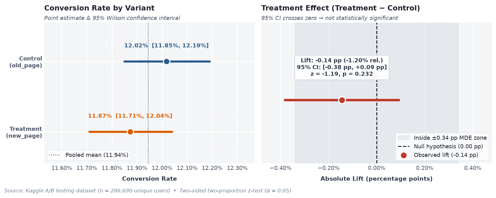

# A/B test analysis on landing page social proof


[](LICENSE)

[Versão em português](README.pt-BR.md)

Portfolio analysis of the [Kaggle landing page A/B dataset](https://www.kaggle.com/datasets/zhangluyuan/ab-testing): pre-experiment design, hygiene checks, frequentist and Bayesian inference, cross-checks with [`tea-tasting`](https://github.com/e10v/tea-tasting), and clustered-design simulations with [`cluster-experiments`](https://david26694.github.io/cluster-experiments/).

> **Summary.** The new landing page did not improve conversion. Conversion moved from `12.02%` in control to `11.87%` in treatment, an absolute change of `−0.14 pp` and a relative change of `−1.20%` with `p = 0.232`. Across 286,690 clean users collected over 22 days, the test had 80% power to detect a lift of `±0.34 pp`, or `±2.84%` relative. The Bayesian posterior gives an `11.6%` probability that treatment beats control. **Do not ship** the new page.

**Notebook:** [`analysis.ipynb`](analysis.ipynb) — executed notebook with the full workflow and plots.



## Scorecard

| Stage | Metric | Result | Threshold or 95% interval | Verdict |
|---|---|---|---|---|
| **0. Experiment design** | Target MDE and runtime | `±0.34 pp`, `±2.84%` relative | `N = 286,690`, 22 days, `80%` power, `α = 0.05` | **PRE-SPECIFIED** |
| **0.4 Type M and Type S** | Exaggeration at `80%` MDE vs `+0.5%` | `1.12×` at MDE, `4.84×` at `+0.5%` | Caps winner's curse inflation at `1.12×` | **GUARDED AT ≥2.84%** |
| **1. Data hygiene** | Repeated or mismatched rows | `7,788` rows, `2.64%` dropped | `0` mismatches in `286,690` clean users | **PASS** |
| **2. SRM check** | Control vs treatment split | `143,293` vs `143,397`, ratio `0.9993` | `χ² = 0.0377`, `p = 0.8460`, threshold `0.001` | **PASS** |
| **3. Frequentist z-test** | Absolute and relative lift | `−0.14 pp`, `−1.20%` relative | 95% CI `[−0.38 pp, +0.09 pp]`, `p = 0.2323` | **NOT SIGNIFICANT** |
| **4. Bootstrap 10k** | Resampled lift | `−0.14 pp`, `−1.20%` relative | 95% CI `[−0.39 pp, +0.09 pp]`, `p = 0.2324` | **NOT SIGNIFICANT** |
| **5. Bayesian Beta** | `P(Treatment > Control)` | `11.6%` vs `88.4%` control | 95% CrI `[−0.38 pp, +0.09 pp]` | **DO NOT SHIP** |
| **6. `tea-tasting` MDE** | Sensitivity power check | `±0.34 pp`, `±2.84%` relative | 80% power, two-sided `α = 0.05` | **WELL-POWERED** |
| **7. Clustered OLS** | Store-randomized SE ratio | `SE = $2.92` vs naive `$0.64` | `4.5x` SE ratio, `p = 0.5017` vs `0.0023` | **PREVENTS FALSE POSITIVE** |
| **8. Synthetic control** | 1-treated-cluster false positive rate | `0%` FPR, `100%` power at `+10` | Clustered OLS hits `75%` FPR at `effect = 0` | **REQUIRED FOR N=1 CLUSTER** |

## Full write-up

Methodology notes, diagnostic tables, and the remaining plots live in **[`docs/analysis.md`](docs/analysis.md)** ([português](docs/analysis.pt-BR.md)).

## Repository layout

| File | Description |
|---|---|
| [`analysis.ipynb`](analysis.ipynb) | Executed notebook with the planning section, Type M and Type S audit, statistical tests, and charts |
| [`ab_utils.py`](ab_utils.py) | Shared helpers for tests, ggplot-style plots, `tea-tasting`, and `cluster-experiments` demos |
| `plots/*.png` | Seven two-panel diagnostic charts |
| `data/ab_data.csv` | Raw experiment log |
| [`docs/analysis.md`](docs/analysis.md) | Long-form analysis write-up (English) |

## Quick start

```bash
pip install -r requirements.txt
jupyter notebook analysis.ipynb
```

License: [MIT](LICENSE).