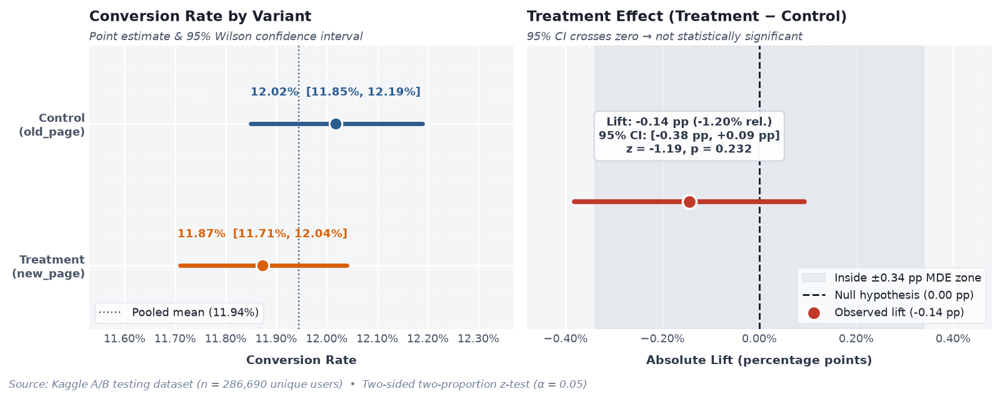
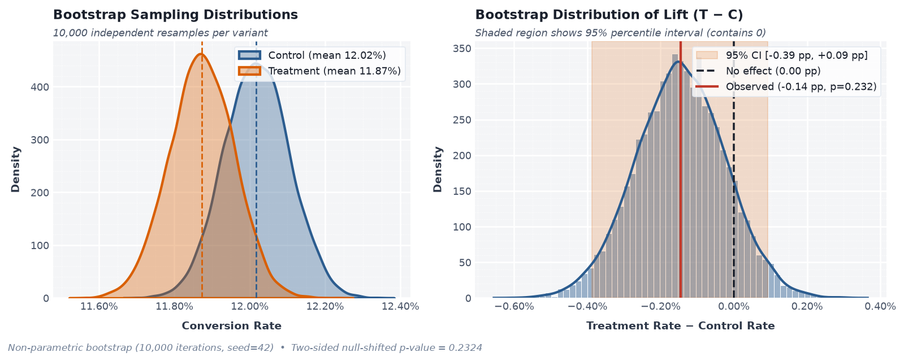
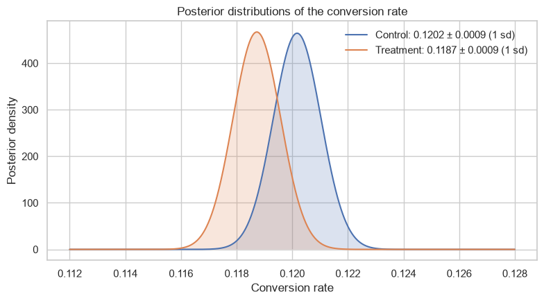
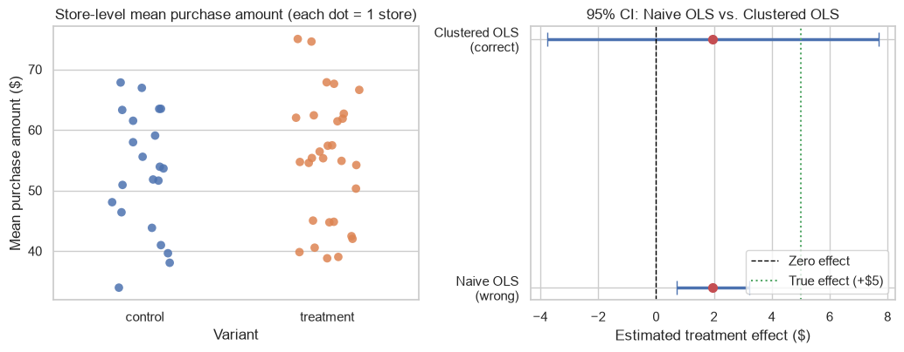
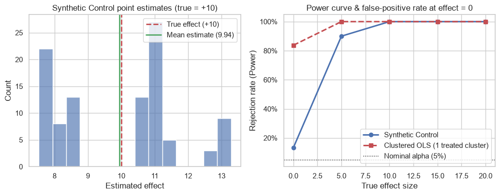

# A/B Test Analysis: Landing Page Social Proof (+ `tea-tasting` & `cluster-experiments`)

🇧🇷 [Versão em português](README.pt-BR.md)

An end-to-end A/B test analysis on a real dataset ([Kaggle](https://www.kaggle.com/datasets/zhangluyuan/ab-testing), ~294k users): data quality checks, Sample Ratio Mismatch, and three statistical approaches (frequentist, bootstrap, Bayesian), cross-checked with [`tea-tasting`](https://github.com/e10v/tea-tasting) and extended with **Cluster Randomization** and **Synthetic Control** examples using [`cluster-experiments`](https://david26694.github.io/cluster-experiments/).

> **TL;DR:** the new landing page did **not** improve conversion (`12.02%` → `11.87%`, `p = 0.232`). With 286,690 clean users, the experiment had 80% power to detect a ±0.34 pp (±2.8% relative) lift, and there is only an **11.6% probability** that the new page beats the old one.

## The problem

The product manager's hypothesis: *adding social proof to the landing page will increase the conversion rate.* Control sees the old page, treatment sees the new page with social proof. The metric is binary conversion (`converted`).

## What's in the repo

| File | Purpose |
|---|---|
| [`analysis.ipynb`](analysis.ipynb) | Full, executed notebook (user-level A/B test + `tea-tasting` + clustered & synthetic control experiments) |
| [`ab_utils.py`](ab_utils.py) | Reusable functions: SRM, Wilson CIs, z-test, bootstrap, Bayesian test, `tea-tasting` comparison, and `cluster-experiments` examples |
| `data/ab_data.csv` | Experiment data (user, timestamp, group, page, converted) |
| [`README.pt-BR.md`](README.pt-BR.md) | Original Portuguese write-up |

## Quick start

```bash
pip install -r requirements.txt
jupyter notebook analysis.ipynb
```

Or use the helpers directly:

```python
from ab_utils import (
    srm_test,
    perform_ab_test_analysis,
    bootstrap_ab_test,
    bayesian_ab_test,
    compare_with_tea_tasting,
    run_cluster_randomization_example,
    run_synthetic_control_example,
)

srm_test(control_count, treatment_count)   # is the traffic split healthy?
perform_ab_test_analysis(df)               # two-proportion z-test + CI of the lift
bootstrap_ab_test(df)                      # resampling, no distributional assumptions
bayesian_ab_test(df)                       # P(treatment > control) + credible interval
compare_with_tea_tasting(df)               # cross-check SRM, z-test, t-test & MDE via tea-tasting
run_cluster_randomization_example()        # Naive OLS vs. Clustered OLS on store-randomized data
run_synthetic_control_example()            # Synthetic Control vs. Clustered OLS (1 treated cluster)
```

## Part I — User-Level Landing Page Experiment

### 1. Data quality
- 294,478 rows, no missing values, no fully duplicated rows.
- **3,894 `user_id`s appear more than once** (7,788 rows); 1,895 of them were exposed to *both* variants.
- **3,893 rows have a group/page mismatch** (control users seeing `new_page` or vice versa).

We drop every row of a repeated user (no rule exists to pick the "right" one). This also removes every mismatch, leaving **286,690 users**.

```text
================================================================
 GROUP / LANDING PAGE CONSISTENCY
================================================================
landing_page  new_page  old_page
group                           
control              0    143293
treatment       143397         0
----------------------------------------------------------------
  [PASS] 0 rows where group and landing page disagree
================================================================
```

### 2. Sample Ratio Mismatch
```text
================================================================
 SAMPLE RATIO MISMATCH (SRM) CHECK
================================================================
  Control users:              143,293
  Treatment users:            143,397
  Difference (C - T):         -104
  Control / Treatment ratio:  0.9993
  Chi-square:                 0.0377
  P-value:                    0.8460  (threshold 0.001)
----------------------------------------------------------------
  [PASS] Traffic split looks healthy - results can be trusted.
================================================================
```

### 3. Frequentist: two-proportion z-test
```text
================================================================
 FREQUENTIST TEST: TWO-PROPORTION Z-TEST
================================================================
  Control rate:               12.0173%  (n=143,293)
  Treatment rate:             11.8726%  (n=143,397)
  Absolute lift:              -0.1447%
  Relative lift:              -1.20%
  95% CI of difference:       [-0.3821%, +0.0927%]
  z-statistic:                -1.1945
  P-value (two-sided):        0.2323  (alpha 0.05)
----------------------------------------------------------------
  [NOT SIGNIFICANT] No statistically significant difference between the groups.
================================================================
```


### 4. Bootstrap (10,000 resamples)
```text
================================================================
 BOOTSTRAP TEST
================================================================
  Resamples:                  10,000  (seed=42)
  Observed difference:        -0.1447%
  95% bootstrap CI:           [-0.3882%, +0.0932%]
  P-value (two-sided):        0.2324  (alpha 0.05)
----------------------------------------------------------------
  [NOT SIGNIFICANT] No statistically significant difference (the CI contains 0).
================================================================
```


### 5. Bayesian (Beta-Binomial, uniform prior)
```text
================================================================
 BAYESIAN TEST (Beta-Binomial, uniform prior)
================================================================
  P(treatment > control):     11.6%
  P(control > treatment):     88.4%
  Expected relative lift:     -1.20%
  95% credible interval:      [-0.3825%, +0.0937%]  (absolute)
----------------------------------------------------------------
  Rule of thumb: act on a result when P(better) is >= 95% (or <= 5%).
================================================================
```


### 6. Cross-check & MDE with `tea-tasting`

Using [`tea-tasting`](https://github.com/e10v/tea-tasting) (`SampleRatio`, `Proportion`, and `Mean`) confirms our exact numbers and adds the **Minimum Detectable Effect (MDE)** at 80% power (`alpha = 0.05`):

```text
================================================================
 TEA-TASTING CROSS-CHECK & POWER (MDE)
================================================================
metric           control treatment rel_effect_size rel_effect_size_ci pvalue
srm               143293    143397               -             [-, -]  0.847
conversion_z       0.120     0.119           -1.2%     [-3.1%, 0.78%]  0.232
conversion_ttest   0.120     0.119           -1.2%     [-3.1%, 0.78%]  0.232
----------------------------------------------------------------
  Minimum Detectable Effect at 80% power, alpha=0.05:
metric     power effect_size rel_effect_size  n_obs
conversion   80%     0.00339            2.8% 286690
================================================================
```

---

## Part II — Clustered Experiments & Synthetic Control (`cluster-experiments`)

When user-level randomization isn't possible due to network interference or operational constraints (e.g., store layouts, city-level pricing, regional rollouts), randomization happens at the **cluster level**. Ignoring that structure leads to severely inflated false-positive rates.

### 7. Cluster Randomization: Naive OLS vs. Clustered OLS
Adapted from the [`cluster-experiments` Cluster Randomization guide](https://david26694.github.io/cluster-experiments/examples/cluster_randomization.html): 50 stores are randomized to control or treatment (+$5 true effect, store-level random effect SD = $10 across ~4,800 transactions). Naive OLS treats transactions as independent, underestimating the standard error by **4.5x** and declaring a false positive (`p = 0.0023`), whereas Clustered OLS properly accounts for intra-store correlation (`p = 0.5017`):

```text
================================================================
 CLUSTER RANDOMIZATION (50 stores, ~4,823 transactions)
================================================================
                        Method  ATE ($)  Std. Error ($)  p-value          95% CI
  Naive OLS (ignores clusters)     1.96            0.64   0.0023  [$0.70, $3.23]
Clustered OLS (store-level SE)     1.96            2.92   0.5017 [$-3.77, $7.69]
----------------------------------------------------------------
  Clustered SE is 4.5x larger than Naive SE due to intra-store correlation.
================================================================
```


### 8. Synthetic Control vs. Clustered OLS (Single Treated Cluster)
Adapted from the [`cluster-experiments` Synthetic Control guide](https://david26694.github.io/cluster-experiments/synthetic_control.html): when **only 1 cluster** receives treatment (e.g., a single city or country launch), even Clustered OLS breaks down — its false-positive rate at `effect = 0` spikes to **84%** instead of the nominal 5%. **Synthetic Control** constructs a counterfactual from pre-intervention donor clusters, keeping the false-positive rate low while reaching 90%–100% power for true effects of +5 to +20:

```text
================================================================
 SYNTHETIC CONTROL vs. CLUSTERED OLS (1 treated cluster)
================================================================
  Point estimate mean (true=+10): 9.94  (sd=1.84)
----------------------------------------------------------------
 Effect size  Synthetic Control power  Clustered OLS power
           0                 0.133333               0.8375
           5                 0.900000               1.0000
          10                 1.000000               1.0000
          15                 1.000000               1.0000
          20                 1.000000               1.0000
----------------------------------------------------------------
  At effect=0 (false-positive rate): Synthetic Control = 13%, Clustered OLS = 84% (breaks with 1 treated cluster!).
================================================================
```


## Conclusion

- **Landing page experiment:** all methods (`ab_utils` z-test, bootstrap, Bayesian, and `tea-tasting`) agree. Treatment converts slightly less than control (`11.87%` vs `12.02%`, `p = 0.232`), well within noise, and the test was well-powered (`MDE = ±0.34 pp` at 80% power). **Do not roll out the new landing page on conversion grounds.**
- **Clustered experiments:** always use cluster-robust standard errors (`clustered_ols`) when randomizing across multiple clusters, and switch to **Synthetic Control** when only one (or very few) clusters receive treatment.

## What changed in this version

A review of the original code fixed several correctness problems and expanded the toolkit:

- **Bootstrap p-value was wrong.** It used `mean(boot_diff > observed)`, which is always ~0.5 because the bootstrap distribution is centered on the observed value. It now uses a two-sided p-value from the null-centered distribution.
- **Bayesian result was mislabeled.** `calc_prob_between(treatment, control)` returns `P(treatment > control) = 11.6%`, which was previously printed as the probability of *losing*.
- **Bayesian probability & plot** now use fast seeded Monte Carlo with a 95% credible interval, and plot `± 1 SD` instead of variance.
- **Frequentist test & CIs** now use an explicit two-proportion z-test with lift CIs and Wilson score intervals for group rates.
- **Added `tea-tasting` comparison & MDE power calculation** (`compare_with_tea_tasting`).
- **Added `cluster-experiments` examples** for store-level Cluster Randomization (`run_cluster_randomization_example`) and single-cluster Synthetic Control (`run_synthetic_control_example`).

## References
- [Trustworthy Online Controlled Experiments](https://www.amazon.com/Trustworthy-Online-Controlled-Experiments-Practical-ebook/dp/B0845Y3DJV) — Kohavi, Tang, Xu
- [`tea-tasting`: statistical analysis of A/B tests in Python](https://github.com/e10v/tea-tasting) — Evgeny Ivanov
- [`cluster-experiments`: Cluster Randomization](https://david26694.github.io/cluster-experiments/examples/cluster_randomization.html) & [Synthetic Control](https://david26694.github.io/cluster-experiments/synthetic_control.html) — David Masip
- [Detecting and avoiding bucket imbalance in A/B tests](https://blog.twitter.com/engineering/en_us/a/2015/detecting-and-avoiding-bucket-imbalance-in-ab-tests) — Twitter Engineering
