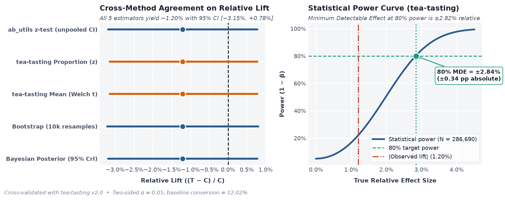

# Análise de Teste A/B: Prova Social em Landing Page (+ `tea-tasting` & `cluster-experiments`)


🇺🇸 [English version (Default)](README.md)

Um projeto completo de experimentação sobre dados reais ([Kaggle](https://www.kaggle.com/datasets/zhangluyuan/ab-testing), ~294 mil usuários): fase de planejamento e hierarquia de métricas, auditoria de qualidade e vazamento entre grupos, verificação de Sample Ratio Mismatch (SRM), três paradigmas estatísticos (frequentista, bootstrap não-paramétrico e Bayesiano), validação cruzada e curva de poder / MDE com [`tea-tasting`](https://github.com/e10v/tea-tasting), além de experimentos com **Randomização por Cluster** e **Controle Sintético** utilizando [`cluster-experiments`](https://david26694.github.io/cluster-experiments/). Todos os gráficos utilizam um tema diagnóstico unificado inspirado em **ggplot2**.

> **Resumo Executivo:** a nova landing page **não** aumentou a conversão (`12.02%` → `11.87%`, `−0.14 pp` absoluto / `−1.20%` relativo, `p = 0.232`). Com 286.690 usuários únicos e limpos (~22 dias de tráfego), o experimento tinha 80% de poder estatístico para detectar um efeito mínimo (MDE) de **±0.34 pp (±2.84% relativo)**, e a análise Bayesiana aponta apenas **11.6% de probabilidade** de a nova página superar o controle. **Recomendação: não implementar a alteração.**

---

## Painel Executivo de Resultados

| Etapa / Método | Métrica Principal | Resultado | Limiar / Intervalo (95%) | Veredito |
|---|---|---|---|---|
| **0. Planejamento** | MDE Alvo e Duração | `±0.34 pp` (`±2.84%` rel.) | `N = 286.690` (~22 dias, `80%` poder, `α = 0.05`) | **PRÉ-ESPECIFICADO** |
| **1. Higiene dos Dados** | Linhas contaminadas / inconsistentes | `7.788` linhas (`2.64%`) removidas | `0` inconsistências em `286.690` usuários | **PASS** |
| **2. Teste de SRM** | Divisão Controle / Tratamento | `143.293` vs `143.397` (`0.9993`) | `χ² = 0.0377`, `p = 0.8460` (`> 0.001`) | **PASS** |
| **3. Frequentista (z-test)** | Lift absoluto / relativo | `−0.14 pp` (`−1.20%`) | IC 95% `[−0.38 pp, +0.09 pp]`, `p = 0.2323` | **NÃO SIGNIFICATIVO** |
| **4. Bootstrap (10k)** | Lift reamostrado | `−0.14 pp` (`−1.20%`) | IC 95% `[−0.39 pp, +0.09 pp]`, `p = 0.2324` | **NÃO SIGNIFICATIVO** |
| **5. Bayesiano (Beta)** | `P(Tratamento > Controle)` | `11.6%` (`88.4%` Controle vence) | CrI 95% `[−0.38 pp, +0.09 pp]` | **NÃO LANÇAR** |
| **6. `tea-tasting` MDE** | Sensibilidade / Curva de Poder | `±0.34 pp` (`±2.84%` relativo) | 80% de poder, bicaudal `α = 0.05` | **BEM DIMENSIONADO** |
| **7. OLS Clusterizado** | Razão de Erro Padrão (lojas) | `EP = $2.92` vs Naive `$0.64` | Inflação de `4.5x` no EP (`p = 0.5017` vs `0.0023`) | **EVITA FALSO POSITIVO** |
| **8. Controle Sintético** | Taxa de Falso Positivo (`efeito=0`) | `0%` FPR (`100%` poder em `+10`) | OLS Clusterizado tem `75%` FPR com 1 cluster tratado | **ESSENCIAL PARA N=1 CLUSTER** |

---

## Estrutura do Repositório

| Arquivo | Descrição |
|---|---|
| [`analysis.ipynb`](analysis.ipynb) | Notebook completo e executado com fase de planejamento, código, relatórios em texto e gráficos estilo ggplot2 |
| [`ab_utils.py`](ab_utils.py) | Funções reutilizáveis: tema ggplot2, SRM, IC de Wilson, teste z, bootstrap, teste Bayesiano, `tea-tasting` e `cluster-experiments` |
| `plots/*.png` | Gráficos diagnósticos de dois painéis em alta resolução (estilo ggplot2) |
| `data/ab_data.csv` | Dados brutos do experimento (`user_id`, `timestamp`, `group`, `landing_page`, `converted`) |
| [`README.md`](README.md) | Documentação principal em inglês |

## Como Executar

```bash
pip install -r requirements.txt
jupyter notebook analysis.ipynb
```

Ou utilizando diretamente as funções em Python:

```python
from ab_utils import (
    srm_test,
    perform_ab_test_analysis,
    bootstrap_ab_test,
    bayesian_ab_test,
    compare_with_tea_tasting,
    run_cluster_randomization_example,
    run_synthetic_control_example,
)

srm_test(control_count, treatment_count)   # checagem de SRM via qui-quadrado (limiar p = 0.001)
perform_ab_test_analysis(df)               # teste z de duas proporções + gráfico ggplot2
bootstrap_ab_test(df)                      # bootstrap de 10k reamostragens + distribuição do lift
bayesian_ab_test(df)                       # posterior Beta-Binomial + probabilidade de vitória
compare_with_tea_tasting(df)               # validação com tea-tasting + curva de poder e MDE
run_cluster_randomization_example()        # OLS Naive vs. OLS Clusterizado em experimento por lojas
run_synthetic_control_example()            # Controle Sintético vs. OLS Clusterizado (1 cluster tratado)
```

---

## Parte I — Experimento da Landing Page (Nível Usuário)

### 0. Fase de Planejamento: Hipótese, Hierarquia de Métricas, Tipo de Teste e MDE

Antes de escrever qualquer linha de código, um experimento confiável começa pela **Fase de Planejamento**, motivada pela demanda do Product Manager:

```text
Olá, Matheus!
Gostaria de testar uma hipótese na nossa landing page: adicionar prova social ("98% dos nossos
clientes estão satisfeitos", "Recomendado pela Forbes, CNN e The New York Times", "Mais de 1 milhão
de clientes satisfeitos") vai aumentar a confiança dos visitantes e elevar a taxa de conversão.

Para testar essa hipótese, vamos dividir os visitantes 50/50 entre a página atual (controle) e a
nova versão com prova social (tratamento) e comparar as taxas de conversão.
```

Seguindo as boas práticas de Kohavi et al. (*Trustworthy Online Controlled Experiments*) e Georgiev (*Statistical Methods in Online A/B Testing*), traduzimos essa demanda em um plano pré-registrado de experimento:

#### 0.1 Hierarquia de Métricas (Primária, Secundárias e Guardrails)
Embora o dataset público do Kaggle forneça apenas a coluna binária `converted`, em produção definimos três camadas de métricas antes do lançamento:
- **Métrica Primária de Decisão (OEC):** `Taxa de Conversão` (`converted` por usuário único) — o critério principal que define se a hipótese foi validada.
- **Métricas Secundárias / Diagnósticas:** `CTR (Click-Through Rate)` no botão principal, `Profundidade de Scroll` (os usuários chegaram a visualizar o bloco de prova social?) e `Tempo até a Conversão` — explicam *por que* a métrica primária subiu ou ficou estável.
- **Métricas de Guardrail (Proteção):**
  - *Guardrails de Sistema / Confiabilidade:* `Sample Ratio Mismatch (SRM)`, `Latência de Carregamento da Página (p95)` (widgets/imagens extras de prova social podem deixar a página mais lenta e prejudicar a conversão) e `Taxa de Erros no Cliente`.
  - *Guardrails de Negócio:* `Bounce Rate`, `Taxa de Cancelamento / Estorno` e `Ticket Médio (AOV)` (garantindo que gatilhos de prova social não atraiam cadastros de baixa qualidade).

#### 0.2 Escolha do Tipo de Teste (Superioridade vs. Não-Inferioridade)
O objetivo de negócio define a formulação da hipótese estatística:
- **Teste de Superioridade (quando lançar exige ganho comprovado):** Se adicionar prova social traz custo de manutenção ou complexidade visual, só lançamos se o Tratamento **superar** o Controle ($H_0: \Delta = 0$ vs. $H_1: \Delta \neq 0$, ou unilateral $H_1: \Delta > 0$).
- **Teste de Não-Inferioridade / Equivalência (redesigns, migrações de plataforma ou rebranding):** Se a nova página for necessária por alinhamento de marca ou atualização tecnológica, não precisamos provar que ela *aumenta* a conversão — basta provar que ela não piora a conversão além de uma **margem de não-inferioridade** pré-acordada $-\Delta_{\text{NI}}$ (ex.: $H_0: p_T - p_C \le -0.25\text{ pp}$ vs. $H_1: p_T - p_C > -0.25\text{ pp}$). Observando nosso IC 95% de `[−0.38 pp, +0.09 pp]`, a nova página falha no teste de superioridade e só passaria em não-inferioridade se a liderança aceitasse uma perda de até `−0.40 pp` (`−3.3%` relativo).

#### 0.3 Definição do MDE e Tamanho Amostral (*A Priori* vs. Sensibilidade Retrospectiva)
O **Efeito Mínimo Detectável (MDE)** é o menor ganho real que justifica o lançamento com um poder estatístico alvo ($1 - \beta = 80\%$) e nível de significância ($\alpha = 0.05$). Ele deve ser definido **no planejamento, antes da coleta**, equilibrando impacto de negócio e volume de tráfego (~13.030 usuários limpos/dia neste dataset, conversão base $p_0 \approx 12.0\%$):

| MDE Relativo Alvo | Lift Absoluto ($\Delta$) | Amostra Total Necessária ($N$) | Duração Estimada (~13k usuários/dia) | Trade-off Prático |
|---|---|---|---|---|
| **±1.00%** | `±0.12 pp` | `2.312.270` | ~177 dias (~25 semanas) | Lento demais para mudança de UI; exige CUPED ou maior tráfego |
| **±2.00%** | `±0.24 pp` | `580.545` | ~45 dias (~6,5 semanas) | Alta precisão, tempo de execução moderado |
| **±2.84% (Este Dataset)** | **`±0.34 pp`** | **`286.690`** | **22 dias (~3 semanas completas)** | **Ponto ideal: 3 ciclos semanais, detecta ≥2.84% com 80% de poder** |
| **±5.00%** | `±0.60 pp` | `94.072` | ~7,2 dias (1 semana completa) | Triagem rápida para mudanças grandes de layout |
| **±10.00%** | `±1.20 pp` | `24.007` | ~2 dias *(estender p/ 7d)* | Nunca encerrar em 2 dias — rodar ao menos 1–2 ciclos semanais completos |

> [!IMPORTANT]
> **Por que não usamos "poder observado pós-teste":** Como destaca Georgiev, calcular o poder estatístico substituindo o efeito ruidoso observado (`−0.14 pp`) após o término do experimento não traz informação válida. Ao auditar um dataset histórico com $N = 286.690$, calculamos o **MDE de sensibilidade retrospectiva (`±0.34 pp` / `±2.84%`)** para responder: *"Qual tamanho de efeito este experimento tinha capacidade real de detectar?"* Como `±2.84%` está abaixo do patamar típico de 3%–5% esperado em mudanças de landing page, o resultado não-significativo (`p = 0.232`) representa uma ausência de efeito bem dimensionada, e não falta de amostra.

---

### 1. Higiene dos Dados e Consistência das Variantes
- **294.478** linhas brutas (`2017-01-02` a `2017-01-24`, ~22 dias), sem valores nulos e sem linhas inteiramente duplicadas.
- **3.894 `user_id`s aparecem mais de uma vez** (7.788 linhas, `2.64%` do tráfego), sendo que **1.895 usuários foram expostos a ambas as variantes** (`control` e `treatment`).
- **3.893 linhas apresentam inconsistência entre grupo e página** (`control` visualizando `new_page` ou `treatment` visualizando `old_page`). Ao remover todos os `user_id`s repetidos, todas as inconsistências são eliminadas, restando **286.690 usuários únicos**:

```text
╭────────────────────────────────────────────────────────────────────╮
│ GROUP / LANDING PAGE CONSISTENCY                                   │
├────────────────────────────────────────────────────────────────────┤
│  landing_page  new_page  old_page                                  │
│  group                                                             │
│  control              0    143293                                  │
│  treatment       143397         0                                  │
├────────────────────────────────────────────────────────────────────┤
│  [PASS] 0 rows where group and landing page disagree               │
╰────────────────────────────────────────────────────────────────────╯
```

### 2. Sample Ratio Mismatch (SRM)
```text
╭────────────────────────────────────────────────────────────────────╮
│ SAMPLE RATIO MISMATCH (SRM) CHECK                                  │
├────────────────────────────────────────────────────────────────────┤
│  Control users:              143,293                               │
│  Treatment users:            143,397                               │
│  Difference (C - T):         -104                                  │
│  Control / Treatment ratio:  0.9993                                │
│  Chi-square:                 0.0377                                │
│  P-value:                    0.8460  (threshold 0.001)             │
├────────────────────────────────────────────────────────────────────┤
│  [PASS] Traffic split looks healthy - results can be trusted.      │
╰────────────────────────────────────────────────────────────────────╯
```

### 3. Análise Frequentista: Teste z de Duas Proporções e IC de Wilson
```text
╭────────────────────────────────────────────────────────────────────╮
│ FREQUENTIST TEST: TWO-PROPORTION Z-TEST                            │
├────────────────────────────────────────────────────────────────────┤
│  Control rate:               12.0173%  (n=143,293)                 │
│  Treatment rate:             11.8726%  (n=143,397)                 │
│  Absolute lift:              -0.1447%                              │
│  Relative lift:              -1.20%                                │
│  95% CI of difference:       [-0.3821%, +0.0927%]                  │
│  z-statistic:                -1.1945                               │
│  P-value (two-sided):        0.2323  (alpha 0.05)                  │
├────────────────────────────────────────────────────────────────────┤
│  [NOT SIGNIFICANT] No statistically significant difference between the groups.│
╰────────────────────────────────────────────────────────────────────╯
```


### 4. Bootstrap Não-Paramétrico (10.000 Reamostragens)
```text
╭────────────────────────────────────────────────────────────────────╮
│ BOOTSTRAP TEST                                                     │
├────────────────────────────────────────────────────────────────────┤
│  Resamples:                  10,000  (seed=42)                     │
│  Observed difference:        -0.1447%                              │
│  95% bootstrap CI:           [-0.3882%, +0.0932%]                  │
│  P-value (two-sided):        0.2324  (alpha 0.05)                  │
├────────────────────────────────────────────────────────────────────┤
│  [NOT SIGNIFICANT] No statistically significant difference (the CI contains 0).│
╰────────────────────────────────────────────────────────────────────╯
```


### 5. Inferência Bayesiana (Modelo Conjugado Beta-Binomial)
```text
╭────────────────────────────────────────────────────────────────────╮
│ BAYESIAN TEST (Beta-Binomial, uniform prior)                       │
├────────────────────────────────────────────────────────────────────┤
│  P(treatment > control):     11.6%                                 │
│  P(control > treatment):     88.4%                                 │
│  Expected relative lift:     -1.20%                                │
│  95% credible interval:      [-0.3825%, +0.0937%]  (absolute)      │
├────────────────────────────────────────────────────────────────────┤
│  Rule of thumb: act on a result when P(better) is >= 95% (or <= 5%).│
╰────────────────────────────────────────────────────────────────────╯
```


### 6. Validação Cruzada e Curva de Poder Estatístico (`tea-tasting`)

Validando nossos resultados com [`tea-tasting`](https://github.com/e10v/tea-tasting) (`SampleRatio`, `Proportion` e `Mean`), confirmamos os valores exatos e calculamos o **Efeito Mínimo Detectável (MDE)** com 80% de poder (`α = 0.05`):

```text
╭────────────────────────────────────────────────────────────────────╮
│ TEA-TASTING CROSS-CHECK & POWER (MDE)                              │
├────────────────────────────────────────────────────────────────────┤
│  metric           control treatment rel_effect_size rel_effect_size_ci pvalue│
│  srm               143293    143397               -             [-, -]  0.847│
│  conversion_z       0.120     0.119           -1.2%     [-3.1%, 0.78%]  0.232│
│  conversion_ttest   0.120     0.119           -1.2%     [-3.1%, 0.78%]  0.232│
├────────────────────────────────────────────────────────────────────┤
│  Minimum Detectable Effect at 80% power, alpha=0.05:               │
│  metric     power effect_size rel_effect_size  n_obs               │
│  conversion   80%     0.00339            2.8% 286690               │
╰────────────────────────────────────────────────────────────────────╯
```


---

## Parte II — Experimentos Clusterizados e Controle Sintético (`cluster-experiments`)

Quando não é possível randomizar no nível do usuário devido a efeitos de interferência/spillover ou restrições operacionais (ex.: layout de lojas físicas, precificação por cidade, campanhas regionais), a randomização ocorre no **nível do cluster**. Ignorar essa estrutura subestima severamente os erros padrão e infla a taxa de falsos positivos.

### 7. Randomização por Cluster: OLS Naive vs. OLS Clusterizado
Adaptado do [guia de Cluster Randomization do `cluster-experiments`](https://david26694.github.io/cluster-experiments/examples/cluster_randomization.html): 50 lojas são sorteadas entre controle e tratamento (`+$5` de efeito real, efeito aleatório por loja com `DP = $10` ao longo de ~4.823 transações). O OLS Naive trata transações como independentes, subestimando o erro padrão em **4.5x** e gerando um falso positivo (`p = 0.0023`), enquanto o OLS Clusterizado corrige para a correlação intra-loja (`p = 0.5017`):

```text
╭────────────────────────────────────────────────────────────────────╮
│ CLUSTER RANDOMIZATION (50 stores, ~4,823 transactions)             │
├────────────────────────────────────────────────────────────────────┤
│                          Method  ATE ($)  Std. Error ($)  p-value          95% CI│
│    Naive OLS (ignores clusters)     1.96            0.64   0.0023  [$0.70, $3.23]│
│  Clustered OLS (store-level SE)     1.96            2.92   0.5017 [$-3.77, $7.69]│
├────────────────────────────────────────────────────────────────────┤
│  [INSIGHT] Clustered SE is 4.5x larger than Naive SE (prevents false positive!).│
╰────────────────────────────────────────────────────────────────────╯
```


### 8. Controle Sintético vs. OLS Clusterizado (Apenas 1 Cluster Tratado)
Adaptado do [guia de Synthetic Control do `cluster-experiments`](https://david26694.github.io/cluster-experiments/synthetic_control.html): quando **apenas 1 cluster** recebe o tratamento (ex.: lançamento em uma única cidade ou região), até mesmo o OLS Clusterizado falha — sua taxa de falso positivo em `efeito = 0` salta para **75%** (em vez dos 5% nominais). O **Controle Sintético** constrói um contrafactual ponderado a partir dos clusters doadores no período pré-intervenção, mantendo os falsos positivos em **0%** quando `efeito = 0` e alcançando **100% de poder** para efeitos reais a partir de `+10`:

```text
╭────────────────────────────────────────────────────────────────────╮
│ SYNTHETIC CONTROL vs. CLUSTERED OLS (1 treated cluster)            │
├────────────────────────────────────────────────────────────────────┤
│  Point estimate mean (true=+10):10.27  (sd=1.64)                   │
├────────────────────────────────────────────────────────────────────┤
│   Effect size  Synthetic Control power  Clustered OLS power        │
│             0                    0.000                 0.75        │
│             5                    0.625                 1.00        │
│            10                    1.000                 1.00        │
│            15                    1.000                 1.00        │
│            20                    1.000                 1.00        │
├────────────────────────────────────────────────────────────────────┤
│  [INSIGHT] At effect=0 (FPR): Synthetic Control=0% vs Clustered OLS=75%!│
╰────────────────────────────────────────────────────────────────────╯
```


---

## Referências
- [Trustworthy Online Controlled Experiments: A Practical Guide to A/B Testing](https://www.amazon.com/Trustworthy-Online-Controlled-Experiments-Practical-ebook/dp/B0845Y3DJV) — Ron Kohavi, Diane Tang, Ya Xu
- [Statistical Methods in Online A/B Testing: Statistics for data-driven business decisions and risk management in e-commerce](https://www.amazon.com/Statistical-Methods-Online-Testing-data-driven/dp/1694079725) — Georgi Z. Georgiev
- [`tea-tasting`: statistical analysis of A/B tests in Python](https://github.com/e10v/tea-tasting) — Evgeny Ivanov
- [`cluster-experiments`: Cluster Randomization](https://david26694.github.io/cluster-experiments/examples/cluster_randomization.html) & [Synthetic Control](https://david26694.github.io/cluster-experiments/synthetic_control.html) — David Masip
- [Detecting and avoiding bucket imbalance in A/B tests](https://blog.twitter.com/engineering/en_us/a/2015/detecting-and-avoiding-bucket-imbalance-in-ab-tests) — Twitter Engineering
