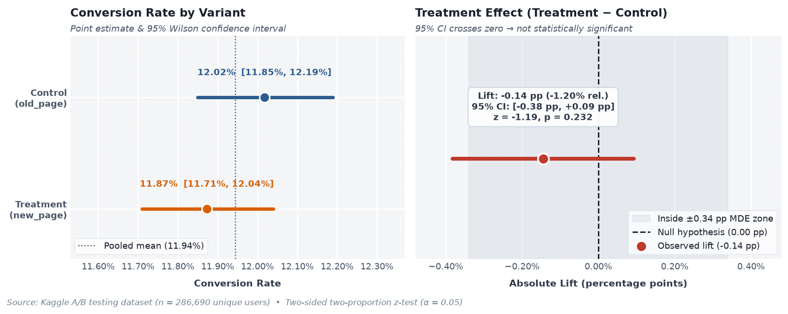

# Análise de teste A/B com prova social em landing page


[](LICENSE)

[English version](README.md)

Análise em portfólio do [dataset de A/B de landing page do Kaggle](https://www.kaggle.com/datasets/zhangluyuan/ab-testing): planejamento pré-experimento, higiene de dados, inferência frequentista e Bayesiana, validação com [`tea-tasting`](https://github.com/e10v/tea-tasting) e simulações clusterizadas com [`cluster-experiments`](https://david26694.github.io/cluster-experiments/).

> **Resumo.** A nova landing page não aumentou a conversão. A taxa passou de `12.02%` no controle para `11.87%` no tratamento, uma diferença absoluta de `−0.14 pp` e relativa de `−1.20%`, com `p = 0.232`. Com 286.690 usuários únicos coletados em 22 dias, o teste tinha 80% de poder estatístico para detectar um efeito mínimo, ou MDE, de `±0.34 pp`, equivalente a `±2.84%` relativo. A distribuição posterior Bayesiana indica `11.6%` de probabilidade de o tratamento superar o controle. **Não lançar** a mudança.

**Notebook:** [`analysis.ipynb`](analysis.ipynb) — notebook executado com o fluxo completo e os gráficos.



## Painel de resultados

| Etapa | Métrica | Resultado | Limiar ou intervalo de 95% | Veredito |
|---|---|---|---|---|
| **0. Planejamento** | MDE alvo e duração | `±0.34 pp`, `±2.84%` relativo | `N = 286.690`, 22 dias, `80%` poder, `α = 0.05` | **PRÉ-ESPECIFICADO** |
| **0.4 Erro Tipo M e S** | Exagero no MDE de `80%` vs `+0.5%` | `1.12×` no MDE, `4.84×` em `+0.5%` | Limita a inflação de magnitude a `1.12×` | **PROTEGIDO EM ≥2.84%** |
| **1. Higiene dos dados** | Linhas repetidas ou inconsistentes | `7.788` linhas, `2.64%` removidas | `0` inconsistências em `286.690` usuários | **PASS** |
| **2. Teste de SRM** | Divisão controle vs tratamento | `143.293` vs `143.397`, razão `0.9993` | `χ² = 0.0377`, `p = 0.8460`, limiar `0.001` | **PASS** |
| **3. Teste z frequentista** | Lift absoluto e relativo | `−0.14 pp`, `−1.20%` relativo | IC 95% `[−0.38 pp, +0.09 pp]`, `p = 0.2323` | **NÃO SIGNIFICATIVO** |
| **4. Bootstrap 10k** | Lift reamostrado | `−0.14 pp`, `−1.20%` relativo | IC 95% `[−0.39 pp, +0.09 pp]`, `p = 0.2324` | **NÃO SIGNIFICATIVO** |
| **5. Bayesiano Beta** | `P(Tratamento > Controle)` | `11.6%` vs `88.4%` controle | CrI 95% `[−0.38 pp, +0.09 pp]` | **NÃO LANÇAR** |
| **6. `tea-tasting` MDE** | Sensibilidade e curva de poder | `±0.34 pp`, `±2.84%` relativo | 80% de poder, bicaudal `α = 0.05` | **BEM DIMENSIONADO** |
| **7. OLS clusterizado** | Razão de erro padrão entre lojas | `EP = $2.92` vs naive `$0.64` | Razão de `4.5x`, `p = 0.5017` vs `0.0023` | **EVITA FALSO POSITIVO** |
| **8. Controle sintético** | Falso positivo com 1 cluster tratado | `0%` FPR, `100%` poder em `+10` | OLS clusterizado tem `75%` FPR em `efeito = 0` | **ESSENCIAL PARA N=1 CLUSTER** |

## Documentação completa

Notas metodológicas, tabelas diagnósticas e os demais gráficos estão em **[`docs/analysis.pt-BR.md`](docs/analysis.pt-BR.md)** ([English](docs/analysis.md)).

## Arquivos do repositório

| Arquivo | Descrição |
|---|---|
| [`analysis.ipynb`](analysis.ipynb) | Notebook executado com planejamento, auditoria Tipo M e Tipo S, testes estatísticos e gráficos |
| [`ab_utils.py`](ab_utils.py) | Funções compartilhadas para testes, gráficos estilo ggplot, `tea-tasting` e demos de `cluster-experiments` |
| `plots/*.png` | Sete gráficos diagnósticos de dois painéis |
| `data/ab_data.csv` | Log bruto do experimento |
| [`docs/analysis.pt-BR.md`](docs/analysis.pt-BR.md) | Texto longo da análise (português) |

## Como executar

```bash
pip install -r requirements.txt
jupyter notebook analysis.ipynb
```

Licença: [MIT](LICENSE).